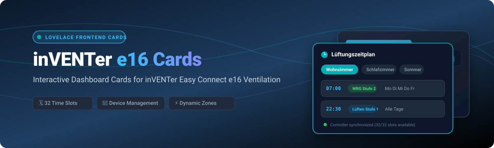

<p align="center">
  
</p>

# inVENTer e16 Lovelace Cards

Custom Lovelace dashboard cards for [Home Assistant](https://www.home-assistant.io/) to control, configure, and monitor ventilation systems driven by the **inVENTer Easy Connect e16** controller.

[](https://github.com/hacs/default)
[](https://github.com/Kadz93/ha-inventer-cards/releases)
[](LICENSE)

<p>
  <a href="https://github.com/topics/home-assistant"></a>
  <a href="https://github.com/topics/inventer"></a>
  <a href="https://github.com/topics/inventer-e16"></a>
  <a href="https://github.com/topics/lovelace"></a>
  <a href="https://github.com/topics/custom-card"></a>
  <a href="https://github.com/topics/ventilation"></a>
  <a href="https://github.com/topics/heat-recovery"></a>
  <a href="https://github.com/topics/hacs"></a>
</p>

---

> [!NOTE]
> ### Lovelace Frontend Cards
> This repository provides frontend dashboard cards (Lovelace Plugins) for Home Assistant.
> * It interfaces with your ventilation system in combination with the [**ha-inventer-e16**](https://github.com/Kadz93/ha-inventer-e16) integration, which manages physical controller communications and exposes standard Home Assistant entities.

---

## Repository Structure

Organized cleanly into modular directories:

```text
ha-inventer-cards/
├── assets/                     # Graphics, vector banners, architecture diagrams & icons
│   ├── banner.svg
│   ├── architecture.svg
│   └── icons/
├── dist/                       # Production-ready JavaScript bundles for Lovelace & HACS
│   ├── inventer-e16-cards.js           (Combined bundle of both cards)
│   ├── inventer-e16-schedule-card.js   (Standalone schedule card)
│   └── inventer-e16-devices-card.js    (Standalone devices card)
├── docs/                       # In-depth technical documentation & references
│   ├── index.md
│   ├── architecture.md                 (Frontend vs backend, WebSockets, service calls)
│   ├── lifecycle-and-fetching.md       (Initial fetch latch, pre-write sync, slot memory)
│   ├── troubleshooting.md              (Common issues, HACS category, entity matching)
│   └── cards/
│       ├── schedule-card.md            (Full schedule card reference & slot allocation)
│       └── devices-card.md             (Full devices card reference & dynamic zones)
├── scripts/                    # Automation & build helpers
│   └── build.py                        (Bundles src modules into dist)
├── src/                        # Unbundled source modules
├── hacs.json                   # HACS repository manifest (plugin)
├── LICENSE                     # MIT license
└── README.md                   # Project overview & quick start
```

---

## Included Cards

| Card | Custom Element Tag | Description |
|---|---|---|
|  **Time Schedule Card** | `custom:inventer-e16-schedule-card` | Manage daily/weekly timetables across all profiles (Living Room, Bedroom, Summer, Custom 1–9) with direct 32-slot controller memory synchronization. |
|  **Devices & Zones Card** | `custom:inventer-e16-devices-card` | Live telemetry for all paired wireless units (iV14-Zero fans, sensors), 1-click zone reassignment, and scheduled dynamic zone switches. |

---

## Installation

### Method 1: Via HACS (Recommended)

1. Open **HACS** in your Home Assistant dashboard.
2. Go to **Frontend** (or **Dashboards**).
3. Search for **inVENTer e16 Lovelace Cards**.
4. Click **Download**, then select **Download** to pull the latest release.
5. Refresh your browser (or clear cache: `Ctrl + F5` / `Cmd + Shift + R`).

> [!NOTE]
> Installing via HACS loads `dist/inventer-e16-cards.js`, which automatically registers both custom elements:
> - `custom:inventer-e16-schedule-card`
> - `custom:inventer-e16-devices-card`

*(Development / Custom testing)*: If testing before official inclusion in the HACS default store, you can also add this repository as a custom repository under category **Dashboard**.

### Method 2: Manual Installation

1. Download `inventer-e16-cards.js` from the [`dist/`](dist/) folder of this repository.
2. Copy the file into your Home Assistant directory: `/config/www/inventer-e16-cards.js`.
3. In Home Assistant, navigate to **Settings → Dashboards → Three dots (⋮) → Resources**.
4. Click **Add Resource**:
   * **URL:** `/local/inventer-e16-cards.js`
   * **Resource Type:** `JavaScript Module`
5. Refresh your dashboard.

---

## How It Works: Initial Fetching & Sync

Unlike standard Lovelace cards that only read static entities from Home Assistant, the inVENTer e16 cards actively interface with the physical controller's internal memory:

1. **Smart Initial Fetching**:  
   To avoid flooding the controller on every minor entity state change, the cards utilize an initialization latch (`_initialFetchDone`). When the card first connects to Home Assistant, it queries the backend via WebSocket (`sendMessagePromise`) to pull the full schedule or device registry into the card state.
2. **Pre-Write Synchronization**:  
   Before any schedule entry is added, updated, or deleted, the card performs a fresh sync with the controller hardware. This eliminates race conditions and ensures slot allocation (slots 0–31) stays coherent even if another client modified schedules simultaneously.
3. **Over-The-Air RF Polling**:  
   The Devices card offers an on-demand refresh button (🔄) that triggers active 868 MHz wireless polling across all fans and indoor/outdoor sensors.

📖 *For a complete deep dive into card lifecycles, WebSocket service calls, and concurrency handling, read the [**Card Lifecycle & Initial Fetching Documentation**](docs/lifecycle-and-fetching.md).*

---

## Quick Configuration Examples

### 1. Schedule Card

```yaml
type: custom:inventer-e16-schedule-card
title: Ventilation Schedules
entity: fan.inventer_living_room   # Optional, auto-detected if omitted
default_profile: living_room       # Default profile tab opened on load
```

*See full options and timetable features in the [**Schedule Card Documentation**](docs/cards/schedule-card.md).*

### 2. Devices & Zone Card

```yaml
type: custom:inventer-e16-devices-card
title: Ventilation Devices & Zones
entity: fan.inventer_living_room   # Optional, auto-detected if omitted
```

*See full options, dynamic zones, and telemetry details in the [**Devices Card Documentation**](docs/cards/devices-card.md).*

---

## Extended Documentation

* 📚 [**Documentation Home**](docs/index.md)
* 🏛️ [**Architecture & System Boundaries**](docs/architecture.md)
* 🔄 [**Card Lifecycle & Initial Fetching**](docs/lifecycle-and-fetching.md)
* 🗓️ [**Schedule Card Reference**](docs/cards/schedule-card.md)
* 📡 [**Devices Card Reference**](docs/cards/devices-card.md)
* ❓ [**Troubleshooting & FAQ**](docs/troubleshooting.md)

---

## Requirements

* **Home Assistant**: 2024.1.0 or newer.
* **Backend Integration**: [**ha-inventer-e16**](https://github.com/Kadz93/ha-inventer-e16) installed and configured with your inVENTer Easy Connect e16 controller.

---

## License

This project is open-source and licensed under the [MIT License](LICENSE).
