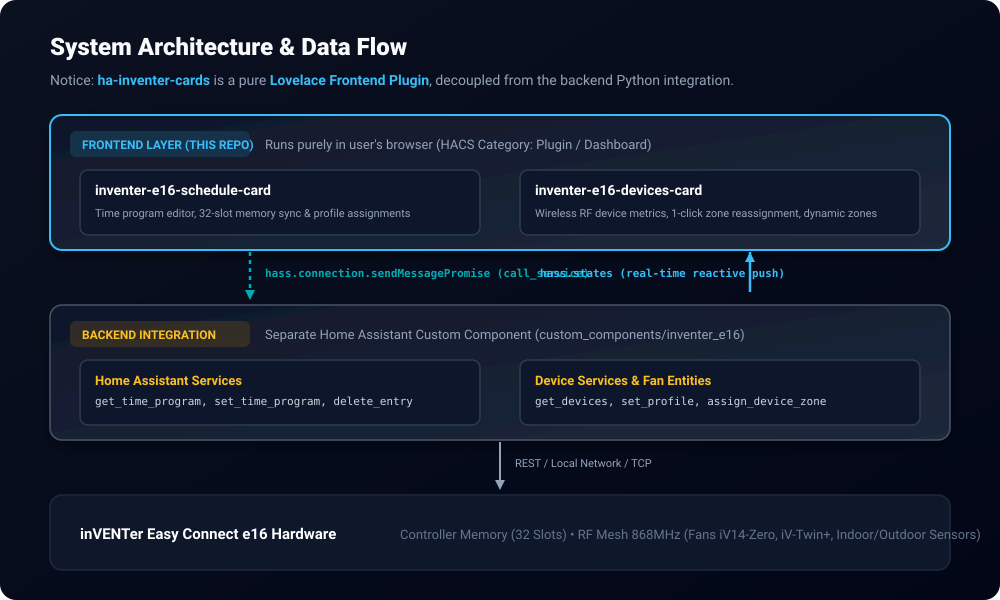

# inVENTer e16 Lovelace Cards Documentation

Welcome to the technical documentation for **inVENTer e16 Lovelace Cards**.

This project provides custom dashboard cards for [Home Assistant](https://www.home-assistant.io/) to monitor, manage, and configure ventilation systems powered by the **inVENTer Easy Connect e16** controller.

---

> [!NOTE]
> ### Lovelace Frontend Cards (HACS Plugin)
> This repository is a **Lovelace Frontend Plugin** (`category: plugin` / `dashboard`).
> * It does not contain Python backend components (`custom_components`).
> * It requires the backend integration [**ha-inventer-e16**](https://github.com/Kadz93/ha-inventer-e16) to communicate with your physical inVENTer e16 controller.

---

## Documentation Contents

1. [**Architecture & Data Flow**](architecture.md)  
   Detailed breakdown of how the frontend cards interface with Home Assistant, service boundaries, WebSocket calls, and controller interaction.

2. [**Card Lifecycle & Initial Fetching**](lifecycle-and-fetching.md)  
   In-depth explanation of card initialization, the `_initialFetchDone` guard, pre-write controller synchronization, slot assignment, and reactive state updates.

3. [**Schedule Management Card**](cards/schedule-card.md)  
   Reference guide for `custom:inventer-e16-schedule-card`: profiles, timetables, mode and speed settings, and 1-click zone profile activation.

4. [**Device & Zone Management Card**](cards/devices-card.md)  
   Reference guide for `custom:inventer-e16-devices-card`: RF device discovery, live telemetry, 1-click zone reassignment, and scheduled dynamic zone switching.

5. [**Troubleshooting & FAQ**](troubleshooting.md)  
   Solutions to common setup issues, HACS repository classification, entity discovery tips, and browser cache issues.

---

## Quick Navigation

| Topic | Primary Documentation | Key Concepts |
|---|---|---|
| **What is this?** | [Architecture](architecture.md) | Frontend Plugin vs Backend Integration |
| **How data is loaded** | [Lifecycle & Fetching](lifecycle-and-fetching.md) | Initial fetch, `sendMessagePromise`, pre-write sync |
| **Editing Schedules** | [Schedule Card](cards/schedule-card.md) | 32 controller slots, modes (WRG, Ventilation, Pause) |
| **Moving Devices to Zones** | [Devices Card](cards/devices-card.md) | 1-click zone change, scheduled night-time windows |
| **Installation Issues** | [Troubleshooting](troubleshooting.md) | HACS Dashboard category, entity auto-detection |
